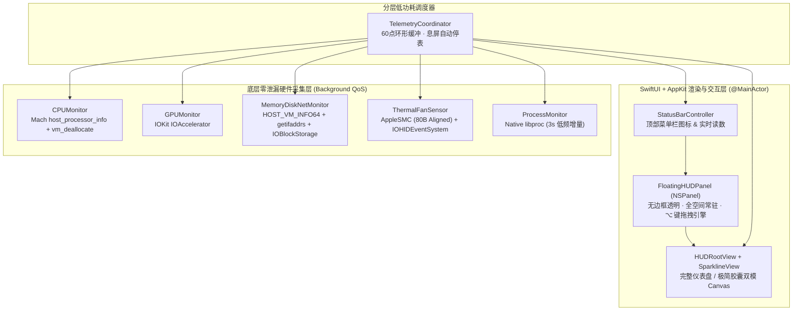

<div align="center">


<br/>

# ⚡ MacPulse HUD

**原生 Swift 6 打造的 macOS 极客桌面透明悬浮性能监控工具**  
*100% 鼠标穿透 · 按住 `⌥ Option` 随手拖拽 · 免 `sudo` 直读 Apple Silicon CPU/GPU/温度/风扇/功耗*

**🇨🇳 简体中文** | [**🇭🇰 繁體中文**](docs/README_ZH-HANT.md) | [**🇺🇸 English**](README_EN.md) | [**🇯🇵 日本語**](docs/README_JA.md) | [**🇰🇷 한국어**](docs/README_KO.md) | [**🇪🇸 Español**](docs/README_ES.md) | [**🇫🇷 Français**](docs/README_FR.md) | [**🇩🇪 Deutsch**](docs/README_DE.md)

[](https://swift.org)
[](https://www.apple.com/macos)
[](https://developer.apple.com)
[](#)
[](#)
[](LICENSE)

</div>

---

## ✨ 为什么做 MacPulse？

市面上的 Mac 监控软件大多只塞在狭小的顶部菜单栏里，或者用 Electron 套壳吃掉几百 MB 内存；而传统的桌面悬浮窗又容易遮挡鼠标点击，在白色网页背景下还会看不清文字。

**MacPulse HUD** 采用 **100% 纯原生 Swift + AppKit (`NSPanel`) + SwiftUI (`Canvas`) + Mach/IOKit/SMC** 构建，解决了桌面常驻监控的五大核心痛点：

1. **🎯 100% 鼠标穿透 + `⌥ Option` 键即时拖拽**
   - 默认开启硬件级鼠标穿透（`ignoresMouseEvents = true`），悬浮在代码编辑器、浏览器或全屏游戏上方时**完全不挡鼠标点击**。
   - 想挪位置？随时**按住键盘 `⌥ Option` 键**，边框即刻高亮解锁，鼠标随手拖到任意位置，松开按键自动落盘保存坐标并恢复穿透。
2. **⚡ 免 `sudo` 密码的全量 Apple Silicon 传感器采集**
   - 无需弹窗索要管理员密码、无需安装 Root 后台服务。
   - 自动识别 `IODeviceTree:/cpus` 拓扑，精确拆分 **性能核 (P-Core)** 与 **能效核 (E-Core)** 负载。
   - 直读 `IOAccelerator` (`AGXAccelerator`) 获取 **GPU 总负载、渲染器 (Renderer)、Tiler 占用与统一显存**。
   - 通过 80 字节精确对齐的 `AppleSMC` 与 `IOHIDEventSystem` 读取 **CPU/GPU/SSD 核心温度 (°C)**、**双风扇实时转速 (RPM)** 及 **整机实时功耗 (`⚡ W`)**。
3. **🌓 全透明与磨砂自适应对比度 + 等宽防抖**
   - 支持从 `0% 纯全透明（带文字发光阴影，白底黑底均清晰）` 到 `88% 深邃熏黑毛玻璃` 多档调节。
   - 全部数字采用 `SF Mono` 等宽字体（`.monospacedDigit()`），数值跳动时绝不左右抖动。
4. **🔄 双视图形态 & 双桌面层级**
   - 一键切换 **完整极客仪表盘 (Dashboard)** 与 **极简胶囊状态条 (Compact Pill)**。
   - 支持 **全局置顶悬浮 (Always on Top)** 与 **嵌入桌面壁纸层 (Desktop Wallpaper Layer)**。
5. **🛡️ 零内存泄漏与息屏零功耗**
   - 每次调用 Mach `host_processor_info` 后严格执行 `vm_deallocate` 释放内核页；Top 进程采用原生 `<libproc.h>` 每 3 秒低频增量采样（绝不拉起外部 `ps` 进程）。
   - 监听系统息屏通知（`screensDidSleep`）自动 100% 暂停定时器；外接显示器拔出时自动将悬浮窗吸附回主屏幕可视区。
6. **🌐 内置 8 国常用语言实时热切换**
   - 默认自动跟随 macOS 系统语言，并支持在顶部菜单栏一键无感切换：**简体中文、繁體中文、English、日本語、한국어、Español、Français、Deutsch**。

---

## 📊 监控指标一览

| 模块 | 监控细项 | 底层数据源 | 采样频率 |
| :--- | :--- | :--- | :---: |
| **CPU** | 总占用率、60 点实时折线波形、**P-Core / E-Core 独立负载条**、单核微型柱状图 | Mach `host_processor_info` + `IODeviceTree:/cpus` | `1.0s` (可调) |
| **GPU** | 设备总负载、60 点实时波形、**Renderer / Tiler 占用率**、统一显存占用 (MB) | IOKit `IOAccelerator` (`PerformanceStatistics`) | `1.0s` (可调) |
| **内存 (RAM)** | 已用 / 总量 (GB)、使用率、**内存压力状态（正常/偏高/吃紧）**、联动/压缩内存、**Swap 交换区** | Mach `host_statistics64(HOST_VM_INFO64)` + `sysctl("vm.swapusage")` | `1.0s` (可调) |
| **温度 / 风扇 / 功耗** | **CPU 温度 (°C)**、**GPU 温度 (°C)**、**SSD 温度 (°C)**、**风扇转速 (RPM / 静音停转)**、**整机功耗 (W)** | `AppleSMC` (`Tp*`/`Tg*`/`F*Ac`/`PSTR`) + `IOHIDEventSystem` | `2.0s` |
| **网络 & 磁盘 IO** | 物理网卡实时下行 `↓` / 上行 `↑` 速率、磁盘读取 `R` / 写入 `W` 速率、磁盘剩余空间 | `getifaddrs` (`AF_LINK`) + `IOBlockStorageDriver` + `statfs` | `1.0s` (可调) |
| **Top 进程** | 当前 CPU 占用最高的前 3 个进程名称与百分比 | 原生 `<libproc.h>` (`proc_listallpids` + `PROC_PIDTASKINFO`) | `3.0s` |

---

## 🏗️ 架构设计



---

## 🚀 快速开始 (编译与安装)

### 环境要求
- **macOS 13.0 (Ventura)** 及以上（完美支持 macOS Sonoma / Sequoia / Tahoe）
- **Swift 5.10 / 6.0+**（Xcode Command Line Tools）

### 一键构建并启动

```bash
# 1. 克隆仓库
git clone https://github.com/wuliu21/MacPulse.git
cd MacPulse

# 2. 一键编译 Release 原生二进制并打包签名 MacPulse.app
./build_app.sh

# 3. 启动应用
open MacPulse.app

# (可选) 移动到系统「应用程序」目录
cp -R MacPulse.app /Applications/
```

---

## ⌨️ 交互与快捷键指南

| 操作方式 | 功能说明 |
| :--- | :--- |
| **按住 `⌥ Option` + 鼠标左键拖拽** | 在锁定鼠标穿透状态下，**临时唤醒拖拽模式**，移动悬浮窗位置，松开自动保存坐标并恢复穿透 |
| **点击顶部菜单栏图标** | 打开主控菜单（切换仪表盘/胶囊模式、调节背景透明度 `0%~88%`、切换置顶/壁纸层级、开关子模块） |
| **菜单栏快捷键 `⌘H`** | 快速隐藏 / 显示桌面悬浮窗 |
| **菜单栏快捷键 `⌘L`** | 手动切换「锁定鼠标穿透 / 常驻可拖拽」状态 |
| **菜单栏快捷键 `⌘R`** | 一键将悬浮窗重置回主屏幕右上角默认位置 |
| **菜单栏快捷键 `⌘Q`** | 退出 MacPulse |

---

## 📂 目录结构

```text
MacPulse/
├── Package.swift                                  # Swift Package Manager 配置
├── build_app.sh                                   # Release 编译、组装 .app Bundle 与本地签名脚本
├── assets/
│   └── banner.svg                                 # 矢量高清预览横幅
└── Sources/MacPulse/
    ├── App/
    │   ├── MacPulseApp.swift                      # .accessory 无 Dock 图标应用入口
    │   └── StatusBarController.swift              # 顶部状态栏实时读数与控制菜单
    ├── Models/
    │   └── SystemSnapshot.swift                   # 核心快照数据契约、HUD 偏好设置与格式化器
    ├── Telemetry/
    │   ├── TelemetryCoordinator.swift             # 1s/2s/3s 分层采样调度与息屏休眠管理
    │   ├── CPUMonitor.swift                       # P/E 核拆分与 Mach 内存零泄漏采集
    │   ├── GPUMonitor.swift                       # Apple Silicon IOAccelerator GPU 采集
    │   ├── MemoryDiskNetMonitor.swift             # 物理内存/Swap、网卡速率与磁盘 IO 采集
    │   ├── ThermalFanSensor.swift                 # AppleSMC + IOHID 温度/风扇/功耗采集
    │   └── ProcessMonitor.swift                   # 原生 libproc Top 进程增量采集
    ├── UI/
    │   ├── HUDRootView.swift                      # 仪表盘与胶囊条双模式主视图
    │   └── SparklineView.swift                    # Canvas 硬件加速波形图与单核负载条
    └── Window/
        └── FloatingHUDPanel.swift                 # 鼠标穿透、⌥ 修饰键监听与多屏防丢面板
```

---

## 📄 开源协议

本项目基于 [MIT License](LICENSE) 开源。
