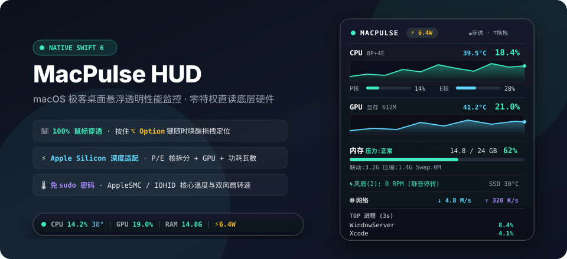

<div align="center">



<br/>

# ⚡ MacPulse HUD

**네이티브 Swift 6 기반 macOS 데스크톱 투명 플로팅 성능 모니터**  
*100% 마우스 투과 · `⌥ Option` 키로 즉시 드래그 · `sudo` 없이 Apple Silicon CPU/GPU/온도/팬/전력 측정*

[**🇨🇳 简体中文**](../README.md) | [**🇭🇰 繁體中文**](README_ZH-HANT.md) | [**🇺🇸 English**](../README_EN.md) | [**🇯🇵 日本語**](README_JA.md) | **🇰🇷 한국어** | [**🇪🇸 Español**](README_ES.md) | [**🇫🇷 Français**](README_FR.md) | [**🇩🇪 Deutsch**](README_DE.md)

</div>

---

## ✨ 주요 특징

1. **🎯 100% 마우스 클릭 투과 + `⌥ Option` 드래그 이동**：기본적으로 마우스 클릭이 아래 창으로 완전히 투과됩니다(`ignoresMouseEvents = true`). 위치를 옮기려면 `⌥ Option` 키를 누른 채로 드래그하면 되며, 키를 떼면 좌표가 자동 저장됩니다.
2. **⚡ `sudo` 비밀번호가 필요 없는 Apple Silicon 하드웨어 센서 수집**：성능 코어(P-Core) 및 효율 코어(E-Core) 분리 로드, `IOAccelerator` GPU 사용률 및 통합 VRAM, 메모리 압력 및 스왑, 그리고 `AppleSMC` / `IOHIDEventSystem`을 통한 CPU/GPU/SSD 온도, 팬 속도(RPM), 실시간 시스템 전력(`⚡ W`)을 루트 권한 없이 읽어옵니다.
3. **🌐 8개 국어 실시간 전환 지원**：메뉴 막대에서 앱 재시작 없이 즉시 언어 전환 가능 (한국어 / 简体中文 / 繁體中文 / English / 日本語 / Español / Français / Deutsch).
4. **🌓 투명도 조절 및 고정폭 숫자 흔들림 방지**：`0%` 완전 투명(발광 텍스트 그림자 적용)부터 `88%` 스모크 블러까지 지원하며, `SF Mono` 고정폭 숫자로 레이아웃 흔들림을 방지합니다.
5. **🛡️ 메모리 누수 제로 & 화면 절전 시 자동 일시정지**：Mach `vm_deallocate`로 커널 메모리 누수를 원천 차단하고, 화면이 꺼지면 타이머를 100% 정지합니다.

---

## 🚀 빠른 시작

```bash
git clone https://github.com/wuliu21/MacPulse.git
cd MacPulse
./build_app.sh
open MacPulse.app
```
